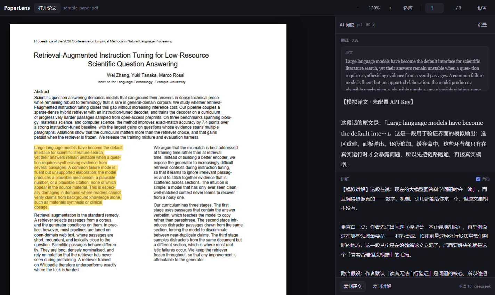

# PaperLens

划选 PDF 论文的任意段落，右侧同时给出中文翻译和大白话讲解。



## 下载

Windows x64 免安装版，见 [Releases](https://github.com/Violit-hub/paperlens-LetsReadPaper/releases)：

| 文件 | 大小 | 说明 |
|---|---|---|
| `PaperLens-win32-x64.zip` | 100 MB | 右键「全部解压缩」 |
| `PaperLens-win32-x64.tar.xz` | 74 MB | 需 `tar -xf` 或 7-Zip |

解压后双击 `PaperLens.exe`，第一次用点「设置」填 DeepSeek 的 API Key。不用装 Node，删文件夹即卸载。

**双击没反应？** 改用 `Start-if-crash.bat`——带 `--no-sandbox`，能绕过部分受限环境下 Chromium 初始化失败的问题。

> 解压后 231 MB，其中 180 MB 是 Electron 内核。语言包已从 40 MB 砍到 0.9 MB，再小就只能换 Tauri（约 8 MB，但要重写后端）。

## 从源码跑

```bash
pnpm install
node node_modules/electron/install.js    # Electron 二进制，国内可先设 ELECTRON_MIRROR
pnpm build && pnpm start
```

开发热更新用 `pnpm dev`；浏览器调试用 `pnpm dev:web`，打开 <http://localhost:5199/?sample=1> 会加载内置示例论文。

> Electron 一启动就崩、且没有日志时，加上 `--no-sandbox --user-data-dir=.userdata`，原因见 [docs/plan.md](docs/plan.md)。

## 用法

1. 打开或拖入 PDF
2. 划选一段
3. 右侧出译文和讲解——可复制、重译、改 prompt

## 特性

- **段落级重建**：双栏不串行，页眉页脚自动排除，`pro- posed` 还原成 `proposed`
- **翻译 + 讲解**：译文首字到达后再生成讲解，不用干等
- **文档级术语表**：打开时抽一次，全文译法一致；面板只列这段用到的
- **缓存**：重复划选 0 请求，改 prompt 自动失效
- **错误提示**：Key 无效、余额不足、限流、断网都有明确结论和下一步
- **模型**：DeepSeek（默认）或本地 Ollama，prompt 可自定义

## 已知限制

- 扫描版 PDF 没有文本层，选不中（需要 OCR，未做）
- 三栏及以上排版会退化
- 跨页选区只覆盖已渲染的页面
- 公式靠 prompt 约束原样保留，没有 LaTeX 还原

## 技术

难点不在调模型，在「你选中的到底是不是一段干净的话」。pdf.js 的文本层是碎片化的绝对定位 span，双栏会串行，而且 PDF 里根本没有空格字符——所以文本必须按几何位置重建。详见 [docs/plan.md](docs/plan.md)。

## License

MIT
